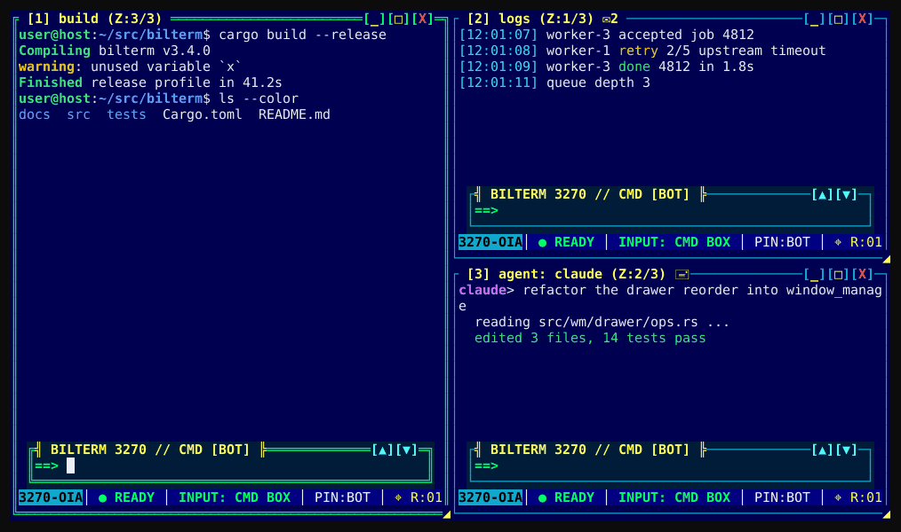
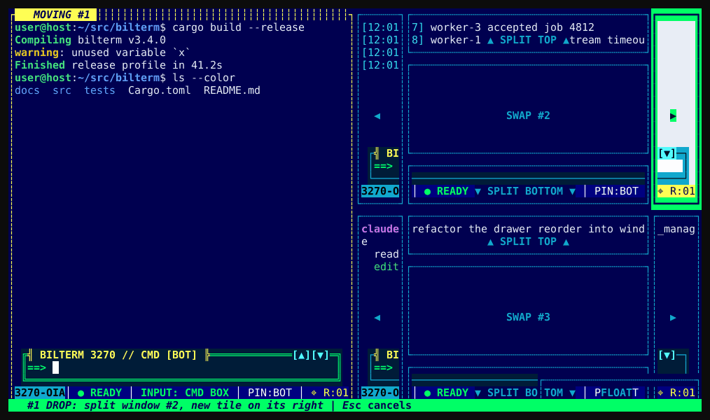
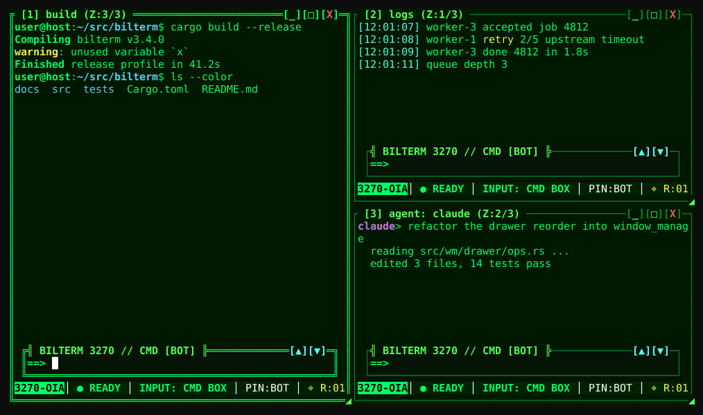
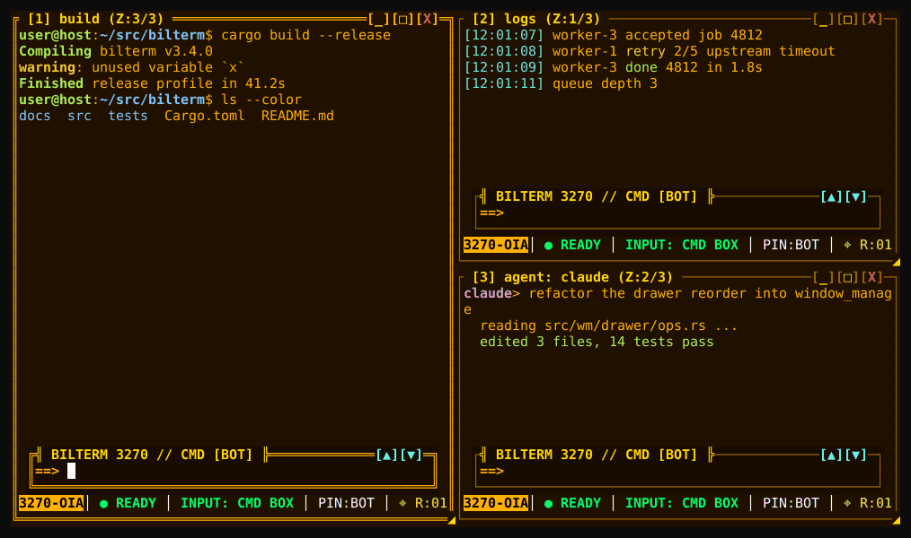
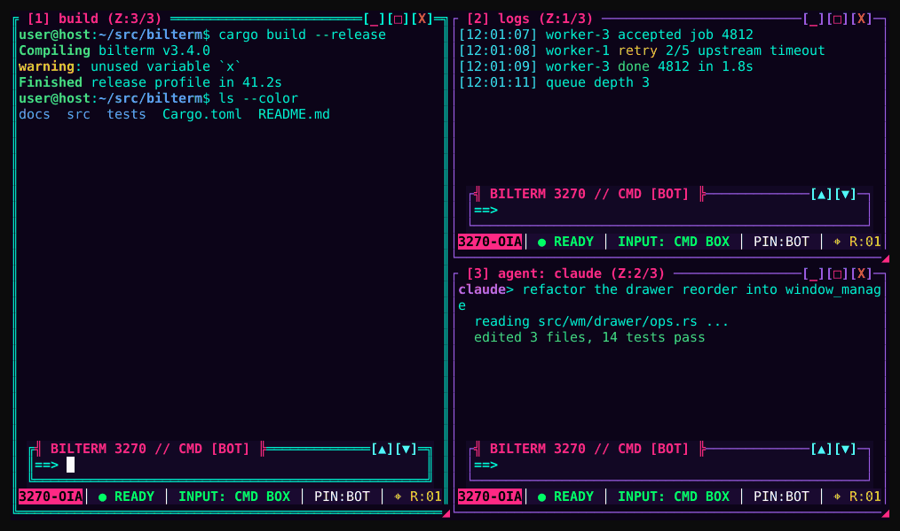

# Bilterm Visual Gallery

[← Back to Project README](../README.md) | [Documentation Hub (`docs/README.md`)](README.md)

Screenshots of the current build (`v3.4.0`). They are generated, not hand edited: `scripts/gen-screenshots.sh` drives a headless window manager through the same actions the keyboard and mouse use, renders the real TUI widget into a cell buffer, and rasterises it to PNG. The output is byte-for-byte reproducible. Scenes live in `examples/gen_screenshots.rs`.

---

## 1. Multi-pane workspace (Turbo Blue)

Three tiled windows with the default Borland Turbo Blue look, the 3270-OIA status row on every window and a bottom-anchored command prompt.

<p align="center">
  
</p>

---

## 2. Navigator drawer (`F7`, `:drawer`)

Sessions, windows and activity sparklines in the left drawer. Rows reorder with `Alt+Up`/`Alt+Down`, `J`/`K`, `:window reorder`, `:session reorder`, or by dragging a row.

<p align="center">
  
</p>

---

## 3. Session find (`Ctrl+X &`, `:find --text ...`)

`Ctrl+X &` prefills the prompt with `:find`; filters (`--pid`, `--pty`, `--cwd`, `--cmd`, `--text`, `--title`) AND together and `:find-flash` highlights the match (the yellow frame).

<p align="center">
  
</p>

---

## 4. Editor and scratchpad with the DOS EDIT style menu bar (`Ctrl+X _`, `F10`)

The built-in editor is an ordinary window. The menu bar (File, Edit, Search, View, Help) opens with `F10`, `Alt+letter` or `:editor menu`; here the Help menu is open.

<p align="center">
  
</p>

---

## 5. Pane-mail envelope

A closed envelope with a count on the `logs` title means unread messages from another session, tool or agent; an open envelope on `agent: claude` means read. `:mail ack` clears it.

<p align="center">
  
</p>

---

## 6. Remote `[R:host]` badge

Windows that live on another machine carry `[R:host]` on the title, in the drawer and on the status line (`:remote status`).

<p align="center">
  
</p>

---

## 7. Drag grip and drop zones (mid-drag)

Dragging a window by its title-bar grip outlines every valid drop zone (swap, split edges, float) and labels the one under the pointer; releasing applies it, `Esc` cancels. `:drag zones on|off` toggles the outlines.

<p align="center">
  
</p>

---

## 8. DOS mode (`:dos run`, opt-in `dos` feature)

A FreeDOS text screen in an ordinary window. DOS mode is built with `--features dos` and needs `:dos setup` to download a pinned emulator; this image feeds a synthetic CGA text screen through the same renderer, it is not a live QEMU session.

<p align="center">
  
</p>

---

## 9. Browser pane (`:browser open <url>`)

The browser pane is a Chrome screencast over the DevTools pipe. This deterministic image uses the built-in placeholder engine (`BILTERM_BROWSER_SYNTHETIC=1`), which is what you get when no Chrome is found.

<p align="center">
  `)" width="920" />
</p>

---

## 10. Themes

Same workspace in four looks (`:theme global <name>`, `:tron`).

| | |
| :---: | :---: |
| <br/>IBM 3278 phosphor green | <br/>IBM 3279 amber |
| <br/>TRON (`:tron`, `--tron`) | <br/>Cyberpunk neon |

---

## Regenerating

```bash
scripts/gen-screenshots.sh              # all scenes -> docs/assets/screenshot-*.png
scripts/gen-screenshots.sh drawer drag-drop   # only these scenes
```

Needs `inkscape` (or `rsvg-convert`) and ImageMagick `convert`; `optipng` is used when installed. Set `CARGO_TARGET_DIR` to a disk location.
